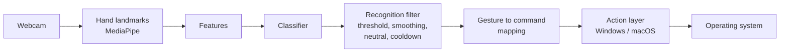

# GestureFlow AI

**Control your computer with your own hand gestures, trained by you in minutes, running 100% locally.**

<!-- Demo GIF goes here once Milestone 4 is done. -->

> **Status: early development (Milestone 0 of 7).** The project structure, tests and CI are in
> place. The webcam view arrives in Milestone 1. See the [roadmap](ROADMAP.md).

## What it does

Record 5–15 examples of a gesture with your webcam, let a lightweight model learn it, and map it
to an action such as play/pause, volume, next track, screenshot or back/forward.

- **Personalized:** you teach it *your* gestures; nothing is hardcoded.
- **Private:** everything runs on your machine. No webcam frames or hand data leave it, and raw
  video is never saved.
- **Safe by design:** confidence threshold, smoothing, cooldowns, a visible "control active"
  indicator and a global emergency hotkey.

## Requirements

| | |
|---|---|
| OS | Windows 10/11 (primary), macOS 11+ on Apple Silicon |
| Python | 3.12 or 3.13 (3.12 recommended) |
| Hardware | Any webcam |

Intel Macs are not supported because MediaPipe does not publish packages for them.

## Install (developer preview)

Full beginner-friendly instructions for Windows and macOS will be added as features land.
If you already have Python 3.12 and Git:

```bash
git clone https://github.com/harsha7777777/gestureflow-ai.git
cd gestureflow-ai
python -m venv .venv
```

Activate the virtual environment:

- Windows (PowerShell): `.venv\Scripts\Activate.ps1`
- macOS: `source .venv/bin/activate`

Then install and run:

```bash
pip install -e ".[dev]"
python -m gestureflow
```

You should see `GestureFlow AI 0.0.1 is installed correctly.`

## Running the tests

```bash
pytest
ruff check .
```

No webcam is needed for the automated tests.

## How it works



The classifier only knows gesture names, and the action layer only knows command names, so you
can remap a gesture without retraining. Details: [docs/architecture.md](docs/architecture.md).

## Privacy

Webcam frames are processed in memory and discarded. Only hand landmark coordinates of the
examples you choose to record are stored, in the local `user_data/` folder, which you can delete
at any time.

## Contributing and license

See [CONTRIBUTING.md](CONTRIBUTING.md) and the [roadmap](ROADMAP.md).
Released under the [MIT License](LICENSE).
