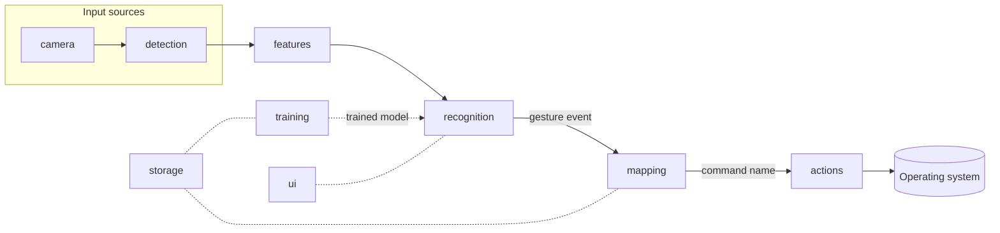

# Architecture

## Pipeline

| Stage | Input | Output | Lives in |
|---|---|---|---|
| camera | webcam index | BGR frames | `gestureflow/camera` |
| detection | frame | 21 hand landmarks (MediaPipe Tasks `HandLandmarker`) | `gestureflow/detection` |
| features | landmarks (one frame or a window) | fixed-length feature vector | `gestureflow/features` |
| training | labeled feature vectors | scikit-learn model + evaluation report | `gestureflow/training` |
| recognition | feature vectors + model | gesture events, after threshold, smoothing, neutral and cooldown | `gestureflow/recognition` |
| mapping | gesture name | command name, e.g. `media.play_pause` | `gestureflow/mapping` |
| actions | command name | OS side effect | `gestureflow/actions` |
| storage | | JSON settings, profiles, mappings; landmark recordings | `gestureflow/storage` |
| ui | | PySide6 windows | `gestureflow/ui` |

## Features (Milestone 2)

**Static poses** (78 numbers per frame): landmarks with x multiplied by the image aspect ratio,
translated to the wrist and divided by hand size (wrist to middle-finger knuckle); plus the 10
distances between fingertips and how extended each finger is (fingertip-to-wrist divided by
knuckle-to-wrist). Moving the hand around the frame or closer to the camera doesn't change them.

**Movements** (153 numbers per window): the window is resampled by time to 16 steps so speed and
frame rate don't matter; then the palm-center path relative to its start (in hand sizes), the net
displacement, the path length, the average pose, and the fingertip positions at four moments (so a
grab, open to fist, differs from a release).

**Motion check:** before a window is ever treated as a movement, either the palm must have got at
least 0.8 hand sizes away from where it started, or a fingertip must have moved at least 0.6 hand
sizes relative to the wrist (`features/dynamic.py: has_enough_motion`). Distance from the start is
used, not path length, so a hand that rests at the edge of the frame or jitters in place never
counts. This is a fixed rule, so it can't be "unlearned" by a badly trained model.

**Recorded examples** are JSON files under `user_data/gestures/<name>/` holding landmarks and
timestamps only (format described in `storage/samples.py`).

## Training and recognition (Milestone 3)

**Two models.** Poses and movements are different problems, so each gets its own classifier
(`training/trainer.py`). The pose model learns from single frames (every frame of a pose example
is a row). The movement model learns from the same kind of window live recognition sees: the last 1.5 s,
cut out of each movement example every 0.1 s (windows that fail the motion check are left out,
since live they are never classified), plus the full recording.
`neutral` examples of either kind are a class in the pose model; neutral movements are a class
in the movement model.

**Honest evaluation.** Two algorithms (random forest, SVM with calibrated probabilities) are
compared with k-fold cross-validation over whole *examples* (k = up to 5, limited by the
gesture with the fewest examples). Frames from one example never appear in both the training and
the test part, which would inflate the accuracy. Pose frames of a held-out example are averaged
into one guess per example, so the confusion matrix counts examples. The algorithm with the
higher held-out accuracy is then trained on everything (ties go to the random forest).

**Live recognition** (`recognition/recognizer.py`): poses are only read while the hand is still
(in the last 0.3 s the palm moved less than 0.35 hand sizes and no fingertip moved more than 0.3,
so a grab in place counts as moving); movements are only read while it is not still and the last
1.5 s pass the motion check. Each path feeds a `RecognitionFilter`
(`recognition/filter.py`): confidence threshold, smoothing (12 of 15 frames for poses, 2 of 3
windows for movements), neutral never fires, a gesture must be released before it can fire
again, and a per-gesture cooldown (1.5 s). After a movement fires, the window is cleared,
nothing fires for 0.8 s, and no other movement fires until the hand has been still once (which
also drops the older motion from the window). The filter only sees names and numbers, so future inputs (eye tracking,
voice) can reuse it.

**Model file:** `user_data/trained/gesture_model.joblib` (joblib/pickle, from scikit-learn).
Pickle files can run code when loaded, so the app only loads the model it trained itself;
profile import/export (M5) will use JSON, never model files.

## Rules

1. **The classifier knows nothing about OS actions.** It predicts gesture *names*.
2. **The action layer receives a command name** and never touches the model.
3. **Remapping never retrains.** Mappings are a separate JSON file from models.
4. **New input sources plug in before mapping.** Eye tracking or voice would produce the same
   kind of event (a named trigger) that gesture recognition produces, so mapping and actions
   stay unchanged.
5. **Training mode never triggers actions.** The mapping stage is disconnected while training.

Rules 1 and 2 are checked automatically by `tests/test_architecture.py`.

## Key decisions

- **MediaPipe Tasks API only** (`HandLandmarker` in `VIDEO` mode), not the legacy
  `mp.solutions` API, which newer MediaPipe releases no longer include.
- **Landmarks, not images, feed the classifier.** 21 points × 3 coordinates is tiny, so a
  RandomForest or SVM trains in seconds on 5–15 examples. Images would need far more data.
- **JSON for settings, mappings and profiles.** Human-readable, easy to import/export and diff.
  SQLite is not justified at this data size.
- **Pinned dependencies** in `requirements.txt`, read by `pyproject.toml`, so there is one source
  of truth and `pip install -e .` installs exactly the tested versions.
- **opencv-contrib-python instead of opencv-python**, because MediaPipe already depends on it and
  the two packages conflict.

## Top technical risks

| Risk | Impact | Mitigation |
|---|---|---|
| False activations from normal hand movement | Unwanted actions, the biggest UX risk | Always-present neutral class trained on everyday movement, confidence threshold, multi-frame smoothing, cooldowns, emergency hotkey, confirmation for disruptive actions. Measured in M6. |
| Small personal datasets (5–15 examples) overfit | Works in the training session, fails later or in new lighting | Scale/translation-normalized landmark features, simple models, held-out evaluation, encourage recording in varied positions. Measured in M6. |
| Swipe detection vs. a resting hand | A hand held at the frame edge looks like a swipe | Motion-magnitude check on the resampled window before classification. |
| Global hotkeys and synthetic input need OS permissions | Silent failure on macOS (Accessibility, Input Monitoring, Screen Recording), which is the primary OS | Detect and show clear error messages; document exact steps in docs/permissions.md. |
| Volume control is OS-specific | No portable API | Per-OS adapters behind one interface (AppleScript via `osascript` on macOS, pycaw on Windows). |
| MediaPipe platform coverage | No Intel Mac wheels; 1.x API is new | Documented limitation; pinned version; a test fails if `HandLandmarker` disappears. |
| Qt and OpenCV event loops | Frozen UI or dropped frames | Capture and inference on a worker thread, results passed to the UI via Qt signals (M1). |
| Latency on low-end laptops | Laggy control | Process at reduced resolution, measure FPS and end-to-end latency (M1, M6). |
