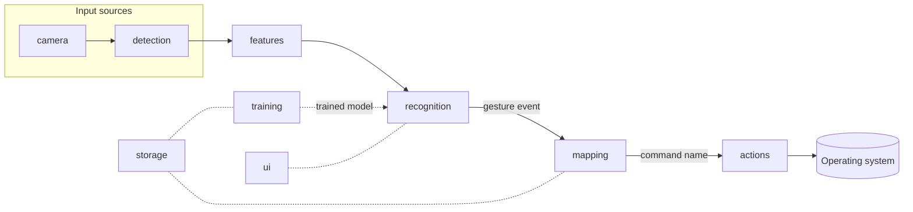

# Architecture

## Pipeline

| Stage | Input | Output | Lives in |
|---|---|---|---|
| camera | webcam index | BGR frames | `gestureflow/camera` |
| detection | frame | 21 hand landmarks (MediaPipe Tasks `HandLandmarker`) | `gestureflow/detection` |
| features | landmarks (one frame or a window) | fixed-length feature vector | `gestureflow/features` |
| training | labeled feature vectors | scikit-learn model + evaluation report | `gestureflow/training` |
| recognition | feature vectors + model | gesture events, after threshold, smoothing, neutral and cooldown | `gestureflow/recognition` |
| mapping | gesture name | command name, e.g. `media.play_pause` | `gestureflow/mapping` |
| actions | command name | OS side effect | `gestureflow/actions` |
| storage | | JSON settings, profiles, mappings; landmark recordings | `gestureflow/storage` |
| ui | | PySide6 windows | `gestureflow/ui` |

## Rules

1. **The classifier knows nothing about OS actions.** It predicts gesture *names*.
2. **The action layer receives a command name** and never touches the model.
3. **Remapping never retrains.** Mappings are a separate JSON file from models.
4. **New input sources plug in before mapping.** Eye tracking or voice would produce the same
   kind of event (a named trigger) that gesture recognition produces, so mapping and actions
   stay unchanged.
5. **Training mode never triggers actions.** The mapping stage is disconnected while training.

Rules 1 and 2 are checked automatically by `tests/test_architecture.py`.

## Key decisions

- **MediaPipe Tasks API only** (`HandLandmarker` in `VIDEO` mode), not the legacy
  `mp.solutions` API, which newer MediaPipe releases no longer include.
- **Landmarks, not images, feed the classifier.** 21 points × 3 coordinates is tiny, so a
  RandomForest or SVM trains in seconds on 5–15 examples. Images would need far more data.
- **JSON for settings, mappings and profiles.** Human-readable, easy to import/export and diff.
  SQLite is not justified at this data size.
- **Pinned dependencies** in `requirements.txt`, read by `pyproject.toml`, so there is one source
  of truth and `pip install -e .` installs exactly the tested versions.
- **opencv-contrib-python instead of opencv-python**, because MediaPipe already depends on it and
  the two packages conflict.

## Top technical risks

| Risk | Impact | Mitigation |
|---|---|---|
| False activations from normal hand movement | Unwanted actions, the biggest UX risk | Always-present neutral class trained on everyday movement, confidence threshold, multi-frame smoothing, cooldowns, emergency hotkey, confirmation for disruptive actions. Measured in M6. |
| Small personal datasets (5–15 examples) overfit | Works in the training session, fails later or in new lighting | Scale/translation-normalized landmark features, simple models, held-out evaluation, encourage recording in varied positions. Measured in M6. |
| Swipe detection vs. a resting hand | A hand held at the frame edge looks like a swipe | Motion-magnitude check on the resampled window before classification. |
| Global hotkeys and synthetic input need OS permissions | Silent failure on macOS (Accessibility, Input Monitoring, Screen Recording), which is the primary OS | Detect and show clear error messages; document exact steps in docs/permissions.md. |
| Volume control is OS-specific | No portable API | Per-OS adapters behind one interface (AppleScript via `osascript` on macOS, pycaw on Windows). |
| MediaPipe platform coverage | No Intel Mac wheels; 1.x API is new | Documented limitation; pinned version; a test fails if `HandLandmarker` disappears. |
| Qt and OpenCV event loops | Frozen UI or dropped frames | Capture and inference on a worker thread, results passed to the UI via Qt signals (M1). |
| Latency on low-end laptops | Laggy control | Process at reduced resolution, measure FPS and end-to-end latency (M1, M6). |
